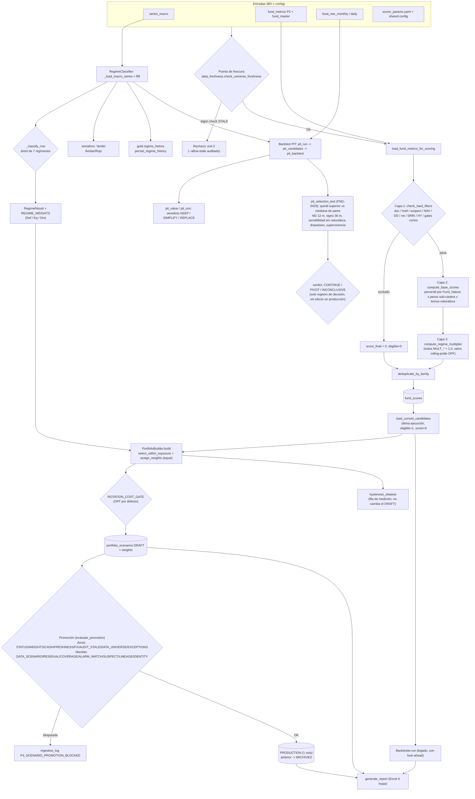

# Inventario Funcional As-Is — `proyecto3`
**Fecha:** 2026-11-17 | **Commit:** 28673e6 | **Ámbito:** `proyecto3/` (src, config, sql; los tests no se auditan: son evidencia, no funcionalidad)

> **Revisión 2026-11-17 (28673e6):** actualización incremental de la edición del 2026-11-16 (b42ee0f). Entre ambos commits solo cambió `proyecto3/src/pit_selection_test.py` (módulo nuevo, FND-0429, leído línea a línea → funcionalidad 13, filas de la matriz, hallazgos H-11, H-12, E-14, E-15) y una línea de `proyecto3/AGENTS.md` (`git diff --stat b42ee0f HEAD -- proyecto3`). El resto del texto se mantiene tal como se verificó el 11-16; sus referencias de línea siguen vigentes porque esos archivos no cambiaron en el rango.

> Auditoría de solo lectura. Las constantes importadas desde fuera de `proyecto3/` (`shared/config.py`, `shared/regime_taxonomy.py`) se leyeron solo para resolver valores exactos; su módulo no se documenta. Las referencias `archivo:línea` son del commit indicado. Los lanzadores (`scripts/launch/p3_build_portfolio.py`, `p3_promote_scenario.py`, `p3_pit_backtest.py`) están **fuera del ámbito**: se citan como disparadores, no se auditan.
> Archivos no leídos línea a línea (solo cabecera, firmas y constantes): `pit_metrics.py`, `pit_peer_metrics.py`, `pit_short_horizon.py`, `pit_macro.py`, `pit_crisis_variants.py`, `pit_value.py` (salvo `verdict`), `pit_oos.py`, `pit_baselines.py`, `pit_cache.py`, `pit_inputs.py`, `backtest_inference.py`, y `monthly_report.py` líneas 885-1027 (hoja macro). `sql/*.sql` no se ha leído.

## 1. Mapa de Flujo del Módulo (End-to-End)

## 2. Catálogo de Funcionalidades del Módulo

### 1. Parametrización del scorer (`scorer_config.py` + `config/scorer_params.yaml`)
* **Objetivo funcional:** concentrar en un YAML validado todos los números ajustables del scorer y exponer un hash de contenido que invalida cachés PIT.
* **Puntos de entrada:** `proyecto3/src/scorer_config.py` (importado al cargar `fund_scorer.py:92`).
* **Entradas y precondiciones:** `scorer_params.yaml`; opcionalmente un overlay YAML por variable `FONDOS_SCORER_PARAMS_OVERLAY` (ruta absoluta).
* **Reglas de negocio y cálculos:**
  1. **Conjunto de claves exacto:** faltan o sobran claves → `ValueError` (`scorer_config.py:54-57`).
  2. **Pesos suman 1:** `BASE_WEIGHTS` y cada `SUBPORTFOLIO_WEIGHTS[s]` con tolerancia 1e-9 (`scorer_config.py:68-72`).
  3. **Cobertura por sub-cartera:** las 6 tablas `SUB_TABLES` y `SUBPORTFOLIO_MAPPING` deben cubrir exactamente las sub-carteras de `SUBPORTFOLIO_WEIGHTS` (`scorer_config.py:73-78`).
  4. **Percentiles de régimen:** `0 <= LOW < HIGH <= 1` (`scorer_config.py:79-80`).
  5. **Ventana común PIT:** `COMMON_WINDOW_MONTHS` ∈ {0} ∪ {≥12 enteros} (`scorer_config.py:65-67`).
  6. **Hash:** SHA-1 del JSON canónico de los parámetros efectivos (`scorer_config.py:137-142`).
* **Controles de calidad y guardas:**
  * **Overlay solo para experimentos PIT:** `assert_no_overlay()` hace que los comandos vivos se nieguen a correr con el overlay activo (`scorer_config.py:130-134`). *Nota:* en `proyecto3/src` no hay ningún llamador de `assert_no_overlay`; el cumplimiento depende de los lanzadores externos (no verificado aquí).
  * Overlay: solo claves existentes, merge a un nivel (`scorer_config.py:99-114`); ruta relativa o inexistente → error (`scorer_config.py:92-95`).
* **Salidas producidas:** dict de parámetros validado; `SCORER_CONFIG_HASH`; `COMMON_WINDOW_MONTHS` (`scorer_config.py:147`).

### 2. Clasificación de régimen macro (`regime_classifier.py`)
* **Objetivo funcional:** decidir en qué régimen (de 7) está la economía cada mes y qué pesos de sub-cartera le corresponden.
* **Puntos de entrada:** `RegimeClassifier(conn, publication_lags=None)`; `classify_current()` (`:571`), `classify_historical()` (`:613`), `semaforo()` (`:709`), `persist_history()` (`:696`), `input_last_dates()` (`:559`), `absolute_target_annual()` (`:683`).
* **Entradas y precondiciones:** `series_macro` con `oil_wti`, `ipc_index` (ES, EU, US, JP, CN), `cli` (EU…), `rate_deposit` EU, `spread_hy`, `vix`, `term_spread` US, `m3_yoy` EU, etc. (`:199-218`). Fechas normalizadas a fin de mes; pivot con `aggfunc="last"` (`:224-232`).
* **Reglas de negocio y cálculos:**
  1. **Derivadas:** `oil_yoy` = pct_change(12) del WTI; `ipc_yoy_es/eu` = pct_change(12) del índice, `ipc_yoy_avg` = media simple ES+EU (`:236-247`); `d_rate_3m` = diff(3) del tipo depósito (`:256`); `vix_yoy` = pct_change(12)×100 (`:307`); `oil_mom`/`vix_mom` = pct_change(1) (`:316-319`).
  2. **Árbol de decisión (orden de prioridad), `_classify_row`:**
     * `Crisis_Financiera`: `spread_hy > 6.0` **Y** `vix_yoy > 30.0` (ambos no nulos) (`:377-380`, constantes `:98-99`).
     * `Shock_Energetico`: `oil_yoy > 0.25` (`:383-385`, `:86`).
     * CLI ausente → `Contraccion` (fail-safe) (`:392-393`).
     * CLI < 100: `Estanflacion` si `ipc_yoy_avg > 0.03`; si no `Contraccion` (`:396-400`, `IPC_MOD_THRESHOLD :88`). Con IPC nulo → `Contraccion`.
     * CLI ≥ 100 e `ipc_yoy_avg > 0.04`: `Recalentamiento_Tardio` si `d_rate_3m > 0`; si no (incl. nulo) `Recalentamiento` (`:403-408`, `IPC_HIGH_THRESHOLD :87`).
     * CLI ≥ 100 y `rate_deposit < 1.0` → `Contraccion` ("desinflación benigna") (`:411-413`, `:93`).
     * Resto → `Expansion` (`:415`).
  3. **Pesos por régimen** (Def/Eq/Din): 70/25/5, 55/35/10, 50/35/15, 60/35/5, 40/40/20, 30/40/30, 20/45/35 (`shared/regime_taxonomy.py:46-54`).
  4. **Régimen actual:** ffill de todas las series y última fila (`:578-579`); un indicador congelado no se ve en la fecha del régimen → `input_last_dates()` expone la fecha real de cada entrada (`:559-569`).
  5. **Histórico:** se salta un mes solo si faltan **a la vez** IPC y CLI (`:657-658`); resultado memoizado, se devuelve copia (`:632-633`).
  6. **Retrasos de publicación (solo backtest):** si se pasan `publication_lags`, `date` se desplaza `lag` meses **antes** de derivar yoy/diff y se descartan filas más allá de la última fecha real (`:172-186`). Valores en `shared/config.py` (`REGIME_PUBLICATION_LAG_MONTHS`: ipc_index, cli, m3_yoy, m2_yoy, m2_global_yoy, unemployment = 2 meses).
  7. **Semáforo:** rojo si el régimen del último mes ≠ el anterior (`:727-732`); señales de indicador (`_semaforo_indicator_signals :472-537`): petróleo MoM >0.20 rojo / >0.08 ámbar; CLI cae >2.0 en 1 mes rojo, o |CLI−100|<1.0 ámbar; IPC acelera >0.006 ámbar; tipo depósito salta ≥0.50 rojo; spread HY >6.0 rojo / >4.0 ámbar; VIX MoM >0.30 rojo / >0.15 ámbar. Con `n_last>1` una señal cuenta solo si se da en cada uno de los últimos n meses, con la severidad mínima (`:738-745`).
  8. **Objetivo absoluto IPC+M3:** `objective_annual(ipc_yoy_avg, m3_yoy)` de `shared/objective.py`, con ffill (`:683-694`).
* **Controles de calidad y guardas:**
  * **Versión del clasificador** `CLASSIFIER_VERSION = "flat-tree-v2"`: un cambio de lógica no pisa el histórico (PK `(date, classifier_version)`) (`:64`, `:422-462`).
  * **Upsert idempotente** con `ON CONFLICT DO UPDATE` (`:451-457`); `dry_run` devuelve el nº de filas sin escribir (`:440-441`).
  * Sin datos macro → `ValueError` en `classify_current` (`:573-574`).
* **Salidas producidas:** `RegimeResult` (régimen, pesos, indicadores); `SemaforoResult`; `gold.regime_history`; informe de texto `current_regime_report` (`:754-785`).

### 3. Scoring de fondos, Capas 1-3 (`fund_scorer.py`)
* **Objetivo funcional:** puntuar cada fondo por sub-cartera y marcar elegibilidad para el régimen activo.
* **Puntos de entrada:** `score_funds(conn, regime_result, score_version="v1", dry_run=False)` (`:1026`); núcleo puro `score_funds_from_df(df, regime)` (`:951`), compartido con el backtest PIT.
* **Entradas y precondiciones:** `fund_metrics` (lista en `scoring_metric_requests :256-307`), `fund_master` del universo activo (`In_Current_Universe = 1`, `:388-395`), `fund_nav_monthly` para elegibilidad. Join interno: lo que no esté en el universo activo no se puntúa (`:399`).
* **Reglas de negocio y cálculos:**
  1. **Mapeo naturaleza→sub-cartera** (un fondo puede puntuar en varias): Defensiva = Monetario, RF Corto Plazo, RF Flexible; Equilibrada = RF Flexible, Mixtos, Renta Variable; Dinámica (`Dinamica` en código) = Renta Variable, Mixtos, Alternativo (`scorer_params.yaml:43-55`).
  2. **Score base (Capa 2):** por cada `Fund_Nature` y métrica, `rank(pct=True, na_option="bottom")` dentro de su naturaleza; suma ponderada con `SUBPORTFOLIO_WEIGHTS` (`:489-558`). Un NaN recibe el percentil más bajo pero **su peso cuenta**; si toda la columna está vacía la métrica se omite (`:533-535`).
     Pesos (retorno real / Sharpe / max_dd / alpha_persistence / capture / momentum): Defensiva 0.20/0.25/0.30/0.15/0.05/0.05; Equilibrada 0.25/0.20/0.20/0.15/0.10/0.10; Dinámica 0.30/0.15/0.15/0.15/0.15/0.10 (`scorer_params.yaml:17-38`).
  3. **Bonus por naturaleza** (multiplica el score base de la naturaleza): Defensiva Monetario 1.25, RF CP 1.10, RF Flex 1.0; Equilibrada Mixtos 1.10, RV 1.0, RF Flex 0.95; Dinámica RV 1.10, Alternativo 1.05, Mixtos 0.95 (`scorer_params.yaml:56-68`, aplicado en `:554-556`).
  4. **max_dd no se invierte:** se guarda ≤ 0, así que mayor = mejor con rank ascendente; `_INVERTED_METRICS` vacío a propósito (`:520`).
  5. **Pesos cortos opcionales:** con `SHORT_HORIZON_SCORING_ENABLED` se añaden `short_return_cum__rolling_3m/6m` (3-5 % según sub-cartera) (`:506-507`, `scorer_params.yaml:147-156`). Por defecto **False** (`shared/config.py:227`); como los pesos base ya suman 1, activarlo hace que los pesos totales superen 1.
  6. **Multiplicador (Capa 3):** `score_final = score_base × mult` si no hay exclusión, si no 0 (`:984`). Todos los `MULT_*` = 1.0 desde FND-0193 (`scorer_params.yaml:96-133`), por lo que `mult == 1.0` salvo las ramas con valores **fijos en código** (ver Hallazgos H-3). Umbrales que siguen definidos pero con efecto nulo: FX 0.60 / `FX_CONTRIBUTION_PP_LIMIT` 0.02, alpha 0.60, crisis MDD −0.10/−0.30, TTR 6/24, pendientes ±0.05, `MIN_OBS_REGIME_SCORING` 12.
  7. **Amortiguación por cobertura:** si `regime_coverage_ratio < 0.43`, `mult = 1 + (mult−1)×0.5` (`:750-754`, `scorer_params.yaml:124-125`). Con `mult==1` no tiene efecto.
  8. **Percentiles de régimen:** p25/p75 del universo de las métricas `return_ann_/sharpe_/sortino_/max_dd_<régimen>`; si no hay historia, todos `None` y el multiplicador empírico queda en 1.0 (`:905-948`).
  9. **Deduplicación por familia:** por `(fund_family_id, subportfolio)` se conserva la clase con mayor `score_final` (desempate `nav_count` si existe); sin familia = representante (`:858-898`).
* **Controles de calidad y guardas (`check_hard_filters :763-851`, en este orden; el primero que dispara devuelve su motivo):**
  * **WRONG_DOC** (`P3_WRONG_DOC_EXCLUSION_ENABLED` ON): `doc_status_reason` (`:778-781`).
  * **Data hold** (`P3_DATA_HOLD_ENABLED` ON): `data_hold_reason` (`:782-785`). El registro `P3_DATA_HOLDS` está **vacío** (`shared/config.py:472`).
  * **Data suspect** (`DATA_SUSPECT_ENABLED` **True**, `shared/config.py:703`): `data_suspect_reason` (`:786-789`).
  * **Elegibilidad de datos** (`FUND_DATA_ELIGIBILITY_ENABLED` ON): `nav_age_days > 60` (`P3_FUND_NAV_MAX_AGE_DAYS`) → `nav_stale`; residual de auditoría aceptado vigente → `accepted_residual`; hueco de NAV (cobertura < 0.80 o racha ≥ 6 meses) → `nav_gap` (`:790-800`, `shared/config.py:448,454,455`).
  * **Drawdown:** `max_dd < límite` — Defensiva −0.20, Equilibrada −0.30, Dinámica −0.40 (`:802-805`, `scorer_params.yaml:73-76`).
  * **Retorno real:** `return_ann_real < límite` — −0.05 / −0.02 / 0.0 (`:807-810`, `scorer_params.yaml:77-80`).
  * **Solo Defensiva:** `srri_nav > 5` y `Credit_Quality == "High Yield"` (`:812-820`).
  * **Gates cortos diarios** (solo si `short_liquidity_flag__rolling_6m` es NaN o ≤ 0.20, fail-open): `short_max_drawdown_6m < −0.08/−0.15/−0.25`; `short_vol_adj_3m > 0.15/0.22/sin límite` (`:825-849`, `scorer_params.yaml:138-146`). Aplican **siempre**, sin interruptor.
  * **Fail-open general:** una métrica ausente o NaN no excluye (`np.isnan` negado en cada filtro).
  * **Persistencia autoritativa:** `_persist_scores` borra y reinserta todas las filas del `(score_version, regime, as_of_date)` en UNA transacción; con entrada vacía no borra nada (`:1141-1159`).
* **Salidas producidas:** DataFrame por (fondo, sub-cartera); filas en `fund_scores` (PK `isin, block, score_version, regime, as_of_date`) con `score_total`, `score_base`, `multiplier`, `score_detail` JSON, `eligible`, `exclusion_reason`, `notes` (`:1112-1139`).

### 4. Carga de elegibilidad de datos y puertas de exclusión (`fund_scorer.load_eligibility_inputs`)
* **Objetivo funcional:** calcular por fondo la antigüedad del último NAV mensual, residuales de auditoría activos y huecos de NAV.
* **Puntos de entrada:** `fund_scorer.py:427` (`load_eligibility_inputs`), `:450` (`_nav_gap_reasons`).
* **Reglas de negocio y cálculos:**
  1. `nav_age_days = (as_of − MAX(date)).days` (`:445`); sin NAV → NaN (no excluye por antigüedad).
  2. **Hueco de NAV:** el predicado vive en `shared/nav_continuity.gap_reason` (misma regla en el PIT, FND-0254) con cobertura mínima 0.80 y racha máxima 6 (`:453-466`).
  3. **Residuales:** se leen de `audit_accepted_finding`; la ausencia de la tabla = sin residuales, no error (`:440-443`).
* **Controles:** `out.join(..., how="outer")` y `reindex` por `isin`; un fondo sin fila en `fund_nav_monthly` queda con `nav_age_days = NaN` y por tanto **pasa** la regla de antigüedad (fail-open).
* **Salidas producidas:** DataFrame `nav_last_date, nav_age_days, residual_reason, nav_gap_reason`.

### 5. Construcción de cartera (`portfolio_engine.py`, `score_candidates.py`, `portfolio_builder.py`)
* **Objetivo funcional:** elegir y ponderar los fondos de las tres sub-carteras bajo las restricciones de diversificación y el presupuesto de divisa, y persistir un escenario DRAFT.
* **Puntos de entrada:** `PortfolioBuilder.build(regime_result, scenario_id, ...)` (`portfolio_builder.py:613`); núcleo puro `select_and_weight` (`portfolio_engine.py:402`) compartido con los backtests.
* **Entradas y precondiciones:** `fund_scores` de la **última ejecución** del `(bloque, score_version, régimen)`: `as_of_date = MAX`, `eligible = 1`, `score_total > 0`, `In_Current_Universe = 1` (`score_candidates.py:84-102`). Se asume que la última ejecución es del universo completo (`score_candidates.py:27-31`).
* **Reglas de negocio y cálculos:**
  1. **Restricciones:** máx. 10 fondos por sub-cartera, 20 % por fondo, 3 % mínimo, 5 de la misma naturaleza por sub-cartera, 2 por gestora (conteo **global** entre sub-carteras), banda de histéresis 0.05 por defecto en `PortfolioConstraints` (`portfolio_engine.py:92-97`; el builder fija `MAX_FUNDS_PER_SUB…MAX_FUNDS_PER_MGR` en `portfolio_builder.py:67-71`).
  2. **Histéresis:** titulares reciben `score × (1 + banda)` solo para ordenar; los pesos usan `score_total` (`portfolio_engine.py:269-278`). Banda viva = `PORTFOLIO_HYSTERESIS_BAND = 0.10` (`shared/config.py:258`), activa solo con `PORTFOLIO_HYSTERESIS_ENABLED` (**False**, `:253`).
  3. **Orden de selección:** `effective_score` descendente; salta ISIN ya usado, familia ya usada (clave `fund_family_id` o, sin ella, las 3 primeras palabras del nombre en mayúsculas), naturaleza con 5, gestora con 2; gestora nula → `"Desconocida"` (`portfolio_engine.py:283-309`). Las sub-carteras se procesan en el orden del dict de pesos (Defensiva, Equilibrada, Dinámica), de modo que **la primera sub-cartera tiene prioridad** sobre los fondos compartidos.
  4. **Presupuesto de divisa no-EUR:** con `FX_EXPOSURE_CONSTRAINT_ENABLED` (True, `shared/config.py:434`) `max_exposed_weight = 0.30`; mientras el peso expuesto de la sub-cartera supere el presupuesto se retira el expuesto de menor score y se reselecciona; el estado compartido solo se muta con la selección final (`portfolio_engine.py:317-364`).
  5. **Ponderación:** `PORTFOLIO_WEIGHT_METHOD = "equal"` (`shared/config.py:269`); `clamp_and_renormalize` (water-filling) en [0.03, 0.20] (`portfolio_engine.py:115-225`). Con `n × 0.20 < 1` (menos de 5 fondos) el tope se respeta estrictamente y el resto queda como liquidez (`:155-160`). Redondeo a 4 decimales por mayor resto (`:57-76`), también para los pesos master (`portfolio_builder.py:125`).
  6. **Peso master** = peso interno × peso de régimen de la sub-cartera; **liquidez** = `max(0, 1 − Σ master)` a 4 decimales (`portfolio_engine.py:46-54`).
  7. **Filtro de coste de rotación** (`ROTATION_COST_GATE_ENABLED` **False**, `shared/config.py:278`): rota solo si `mejora_score > coste/max(score_actual, 0.01) + 0.05`; coste = comisión de salida + de entrada + spread 0.001; comisión por fondo (ratio) → `rotation_costs` (porcentaje ÷100) → defecto 0.5 % salida / 0.0 % entrada (`portfolio_builder.py:280-397`). Una rotación no recomendada se revierte a la misma ranura con el mismo peso (`:466-526`).
  8. **Cartera previa:** solo se carga si `PORTFOLIO_HYSTERESIS_ENABLED`; es la fila `PRODUCTION` distinta del escenario en construcción (con ciclo de vida instalado) o, sin él, la más reciente (`:534-566`, `:643-644`).
* **Controles de calidad y guardas:**
  * **Liquidez estructural declarada:** se imprime qué sub-cartera se queda corta y por qué, y se guarda `cash_weight` en las notas (`portfolio_builder.py:687-695`, `:755`).
  * **Linaje y huella de build:** `metrics_lineage` y `build_identity` en las notas; informativos, nunca fallan el build (`:759-762`).
  * **Nunca sobrescribe:** `_persist` lanza `ScenarioExists` si el escenario existe y no es un DRAFT reemplazado con `--replace-draft` (`:777-784`).
  * Sub-cartera sin candidatos → aviso y sub-cartera vacía (su peso de régimen queda sin asignar → liquidez) (`:674-681`).
  * `clamp_and_renormalize` registra `ERROR` si el suelo es infactible o no converge en 50 iteraciones (`portfolio_engine.py:171-206`).
* **Salidas producidas:** `portfolio_scenarios` (con `notes` JSON: contexto macro, `rotation_plan`, `cash_weight`, `metrics_lineage`, `build_identity`) y `portfolio_weights` (`weight` = peso master, `position_role`, `notes`) (`portfolio_builder.py:769-840`).

### 6. Ciclo de vida del escenario y puerta de promoción (`scenario_lifecycle.py`)
* **Objetivo funcional:** gobernar `DRAFT → PRODUCTION → ARCHIVED` y decidir si un DRAFT puede promoverse.
* **Puntos de entrada:** `evaluate_promotion(...)` (`:225`), `promote(conn, id, username)` (`:431`), `resolve_report_scenario` (`:102`), `build_scenario_id` (`:50`). Disparador: `scripts/launch/p3_promote_scenario.py` (fuera de ámbito).
* **Reglas de negocio y cálculos:**
  1. **Id único por build:** `cartera_<régimen>_<YYYYMM>_b<YYYYMMDDHHMMSS>` (`:50-54`).
  2. **Una sola PRODUCTION:** `promote` archiva la PRODUCTION vigente y promueve el DRAFT en una transacción junto con la fila de auditoría `P3_SCENARIO_PROMOTED`; si `rowcount != 1` se revierte (`:431-451`).
  3. **Puertas DURAS (sin override):** `STATUS` (debe existir y ser DRAFT); `WEIGHTS` (hay pesos y `|Σpesos + liquidez declarada − 1| ≤ tolerancia`; 5e-5 vía orquestador, 1e-3 el legado) (`:198-199`, `:285-289`); `CASH` (`liquidez declarada ≤ MAX_PORTFOLIO_CASH_WEIGHT = 0.10`) (`:290-292`); `FRESHNESS` (cualquier check STALE) (`:293-294`); `FX` (`exposición no-EUR ≤ 0.30`) (`:295-297`); `AUDIT_STALE` (sin auditoría persistida o anterior al DRAFT) (`:304-309`); `DATA_UNIVERSE` (defecto duro abierto fuera de la cartera sin residual vigente) (`:327-330`); `EXCEPTIONS` (historial de residuales ilegible o inconsistente) (`:300-301`).
  4. **Puertas BLANDAS (override con motivo + ticket `FND-nnnn` existente):** `DATA_SCENARIO`, `RESIDUAL_SCENARIO`, `DATA_COVERAGE`, `ALARM_WATCH` (un fondo de PRODUCTION en alarma `DD_CAT_P03`/`VOL_CAT_P97` no puede ganar peso por encima de la tolerancia 1e-4), `DATA_SUSPECT`, `METRICS_LINEAGE`, `AUDIT_IDENTITY` (`:209`, `:310-354`). Ticket inexistente → el override se rechaza; ticket no comprobable (`None`) → no bloquea (`:361`).
  5. **Informe:** nunca recurre a "el más reciente": sin PRODUCTION lanza `NoProductionScenario` salvo `--scenario`/`--draft` (`:102-122`).
* **Controles de calidad y guardas:**
  * `record_blocked` deja **una** fila `P3_SCENARIO_PROMOTION_BLOCKED` por rechazo; su fallo no enmascara el rechazo (`:415-428`).
  * Sin la columna `status` (DDL no aplicado) los ids siguen siendo únicos y el informe falla cerrado (`:57-63`, `:111-114`).
  * `PROMOTION_AUDIT_IDENTITY_GATE_ENABLED` **False** (`shared/config.py:408`): linaje e identidad se calculan y registran en SHADOW sin bloquear (`record_lineage_shadow :397-412`).
* **Salidas producidas:** `PromotionVerdict(blockers, overridden)`; filas `ingestion_log`; `portfolio_scenarios.status/promoted_at/promoted_by/supersedes`.

### 7. Puerta de frescura de datos (`data_freshness.py`)
* **Objetivo funcional:** impedir construir una cartera sobre entradas obsoletas.
* **Puntos de entrada:** `check_universe_freshness(conn, classifier)` (`:294`); `stale_checks` (`:322`); `format_report` (`:326`).
* **Reglas de negocio y cálculos:**
  1. **NAV p10:** percentil 0.10 (`P3_NAV_UNIVERSE_PERCENTILE`) de la fecha del último NAV mensual de cada fondo activo, límite 14 días (`:83-86`, `shared/config.py:386-391`).
  2. **Macro:** cada entrada del clasificador se juzga por su **última fecha real**; límite 45 d (mercado) o 100 d (liberación: `ipc_yoy_avg`, `cli_eu`) (`:91-94`). La edad nunca es negativa (`:41`).
  3. **Harvest:** `MAX(harvest_ts)` de `db_document_catalogue`, límite 45 d (`:96`, `:142`).
  4. **Uniformidad de CALC_VERSION:** ≥ 98 % de los fondos activos con una sola versión (`:109-127`, `P3_MIN_UNIFORM_METRICS_SHARE = 0.98`).
  5. **Patas del compuesto IPC:** estado OK / DEGRADED / BLIND por serie; con `P3_MACRO_LEG_CHECK_ENABLED` (True) bloquea; con False solo avisa (`:152-169`).
  6. **`family_refresh_pending`:** STALE si algún fondo activo espera `--family-nature-refresh` (`:182-193`).
  7. **Canario FX** (con `FX_CONTRIBUTION_EUR_VIEW_ENABLED`): fondos con |fx recomputado| ≥ 1 pp/año deben coincidir con el almacenado ±0.3 pp en ≥ 90 %, con mínimo 8 canarios; menos → STALE (fail-closed) (`:196-217`, muestra determinista `ORDER BY md5(isin)`, 80 candidatos / 25 canarios `:220-238`).
  8. **Cobertura FX** (con `EUR_NAV_CONVERSION_ENABLED`): cada divisa no-EUR debe tener tipos ECB hasta su último NAV (hueco máx. `FX_MAX_GAP_DAYS`); divisa sin tipos → STALE; fondos de divisa desconocida se excluyen y solo se informan (`:241-261`). **Fund_Currency vigente** (`fund_currency_current`): cambio pendiente → STALE (`:264-272`).
* **Controles de calidad y guardas:** un dato ausente es un check FALLIDO ("no hay datos" es el caso más obsoleto) (`:78-79`); el check de universo ignora unos pocos fondos congelados por usar un percentil (`:7-12`).
* **Salidas producidas:** lista de `FreshnessCheck`; el lanzador sale con código `P3_EXIT_STALE_INPUTS = 2` (`shared/config.py:423`).

### 8. Medición de histéresis en sombra (`hysteresis_shadow.py`)
* **Objetivo funcional:** medir mensualmente qué cambiaría el bonus a titulares, sin alterar el DRAFT.
* **Puntos de entrada:** `shadow_after_build(...)` (`:254`), `read_rows` (`:185`), `summary_line` (`:156`).
* **Reglas de negocio y cálculos:**
  1. **Dos flujos:** `one_step` (titulares = PRODUCTION) y `chain` (titulares = cartera ON del mes anterior; el primer mes parte de PRODUCTION) (`:226-251`).
  2. **Rotación:** nocional negociado = Σ|w_nuevo − w_base|; rotación unidireccional = nocional/2; lastre de coste = nocional × 25 pb / 1e4 (`TX_COST_BPS = 25.0`) (`:33`, `:61-73`).
  3. **Estimación de coste de rotación:** empareja salidas y entradas dentro de la misma sub-cartera por peso descendente (una estimación) (`:90-100`).
* **Controles de calidad y guardas:** `shadow_after_build` **nunca lanza**: cualquier fallo es una fila `P3_HYSTERESIS_SHADOW_ERROR` o un aviso impreso (`:265-279`); sin PRODUCTION → `ShadowSkip` (`:229-231`). Nunca lee `PORTFOLIO_HYSTERESIS_ENABLED` (`:8`). Interruptor `P3_HYSTERESIS_SHADOW_ENABLED = True` (`shared/config.py:262`).
* **Salidas producidas:** filas `ingestion_log` `P3_HYSTERESIS_SHADOW` (JSON v1) con pesos, rotación, coste y diferencia de selección.

### 9. Informe mensual (`monthly_report.py`)
* **Objetivo funcional:** generar el Excel de 6 hojas del escenario en PRODUCCIÓN (o de un borrador marcado).
* **Puntos de entrada:** `generate_report(conn, output_dir=None, scenario_id=None, score_version="v1")` (`:1031`).
* **Reglas de negocio y cálculos:**
  1. **Escenario:** PRODUCTION; con `--scenario` fuera de PRODUCTION se marca "NO PRODUCCION", archivo `informe_cartera_<fecha>_<id>.xlsx` en la subcarpeta `borradores` (`:1048-1057`).
  2. **Objetivo IPC+M3:** IPC medio ES+EU yoy por **fecha** (mismo mes un año antes) + M3 yoy EU; aspiración = objetivo + `PORTFOLIO_TARGET_SPREAD` (0.02) (`:110-160`, `shared/config.py:1203`).
  3. **Exceso vs objetivo:** retorno nominal a 1 año − objetivo nominal; si no cuadra → `RuntimeError [GATE:REPORT_EXCESS]` (`:480-486`).
  4. **Reconciliación:** cada retorno de cabecera (YTD, 1 año, desde inicio nominal) se recalcula desde el NAV EUR; diferencia > 5 pb → `RuntimeError [GATE:REPORT_RECONCILIATION]` (con `REPORT_RECONCILIATION_ENABLED`, True) (`:616-627`, `shared/config.py:763-764`).
  5. **Score del informe:** la fila de `fund_scores` más reciente bajo el **mismo régimen que el escenario** (`ps.macro_regime`), `score_version = 'v1'` fijo (`:321-360`).
  6. **Colores informativos de la hoja `1_Cartera`:** alpha_persistence ≥0.60 verde / ≥0.40 ámbar; beta_oil >0.01 verde; beta_rate_eu <−0.10 rojo; |SRRI calc − KIID| ≥2 rojo / 1 ámbar; DD corto 6m <−5 % rojo / <−2 % ámbar; vol ajustada 3m >20 % rojo / >10 % ámbar; liquidez >0.20 ámbar; |fx| >20 ámbar (`:493`, `:502-576`).
  7. **Hoja `3_Backtesting`:** usa el backtester **legado con look-ahead** (`Backtester(conn).run(start_date="2005-01-01")`); el objetivo usado es el **actual** para todo el histórico, con 6 % si no existe (`:759-768`). La hoja lo advierte (`:815-817`).
  8. **Hoja `4_Rotacion`:** solo lee el plan persistido en las notas del escenario; sin plan lo dice (`:822-877`).
* **Controles de calidad y guardas:** los dos `RuntimeError` anteriores abortan el informe completo (no se guarda parcial: `wb.save` está al final, `:1090`). Hoja `2_Regimen`: últimos 120 meses (`:682`).
* **Salidas producidas:** `out/reports/p3/informe_cartera_<YYYYMMDD>.xlsx` (hojas `0_Portada`, `1_Cartera`, `2_Regimen`, `3_Backtesting`, `4_Rotacion`, `5_Macro_Indicadores`).

### 10. Backtest legado con look-ahead (`backtesting.py`: `Backtester.run`)
* **Objetivo funcional:** aproximación rápida (con sesgo conocido) del rendimiento por régimen.
* **Puntos de entrada:** `Backtester(conn).run()` (`:589`), `summary()` (`:676`).
* **Reglas de negocio y cálculos:**
  1. **Selección por régimen:** `select_and_weight` con `exposure_constrained(DEFAULT_CONSTRAINTS)` sobre los scores **actuales** del régimen; cacheado por etiqueta (`:411-445`). Un régimen sin scores propios → candidatos vacíos y aviso; **no** reutiliza scores de otro régimen (`:620-627`, `:141-149`).
  2. **Pesos de sub-cartera por fecha** (de `classify_historical`) (`:642-647`).
  3. **Retorno forward** a 1, 3 y 12 meses (`FORWARD_WINDOWS`, `:65`): peso sin NAV o sin asignar se mantiene en liquidez al tipo depósito BCE devengado con el tipo de inicio de cada mes (`_cash_return :197-224`); sin tipo, devenga 0 y avisa una vez. Sin ningún fondo con dato → `None`, no se fabrica un 100 % liquidez (`:271-281`).
  4. **Benchmark:** media equiponderada de los **primeros `n_funds=100` fondos válidos por orden de columna** (`:284-315`).
  5. **NAV mensual:** vista EUR vía `apply_eur_view_frame`, fechas a fin de mes, base 100 en el primer dato (`:77-111`).
* **Controles de calidad y guardas:** `summary` informa los meses sin evaluar y la cobertura parcial (`:686-706`).
* **Salidas producidas:** DataFrame mensual (`ret_*`, `bench_*`, `excess_*`, `cov_*`, `cash_weight`, `n_funds`).

### 11. Backtest point-in-time (`backtesting.run_pit` + `pit_*.py`)
* **Objetivo funcional:** reproducir mes a mes lo que el modelo de producción habría hecho con la información disponible en cada fecha, y medirlo.
* **Puntos de entrada:** `Backtester.for_pit(...).run_pit(...)` (`backtesting.py:395,447`); lanzador `p3_pit_backtest.py` (fuera de ámbito). Cadena: `pit_inputs` → `pit_metrics` → `pit_peer_metrics` → `pit_short_horizon` → `pit_macro` (opcional) → `pit_run.compute_pit_scores` → `pit_candidates.pit_scores` → `pit_backtest`.
* **Reglas de negocio y cálculos:**
  1. **Universo en t:** fondos con NAV ≤ t no más antiguo que `max_stale_days` (= `P3_FUND_NAV_MAX_AGE_DAYS` = 60) y ≥ `MIN_NAV_ROWS` = 12 observaciones; los fondos con `In_Current_Universe = 0` **se incluyen** salvo `current_universe_only` (contrapeso al sesgo de supervivencia) (`pit_candidates.py:54,148-157`).
  2. **Métricas recalculadas con NAV ≤ t** (ventana expansiva): `return_ann`, `vol_ann`, `sharpe` (con tipo libre de riesgo del mes), `max_dd`, versiones reales deflactadas con IPC retrasado, `srri_nav` (`pit_metrics.py:3-48`). Las definiciones se fijan a las de P2 por tests.
  3. **Métricas de pares replicadas con sus defectos conocidos** (FND-0200, FND-0202) salvo que los interruptores de P2 las corrijan (`pit_peer_metrics.py:15-33`).
  4. **Gates cortos:** `short_max_drawdown_6m` (126 días, mín 90), `short_vol_adj_3m` (63 días, mín 45), `short_liquidity_flag_6m`; **fail-open explícito** con tabla de cobertura (`pit_short_horizon.py:3-27`, `shared/config.py:781-795`).
  5. **Scorer único:** `score_funds_from_df` (el mismo que en vivo) (`pit_candidates.py:180`). El grupo B de métricas (betas macro, fx, régimen, crisis) **no** se recalcula en PIT v1: columnas ausentes → multiplicadores neutros (`pit_candidates.py:17-22`).
  6. **Régimen en t:** última etiqueta ≤ t del clasificador con retrasos de publicación (`pit_candidates.py:144-146`).
  7. **Construcción:** mismo motor (`select_and_weight`), con histéresis opcional (titulares del mes anterior), cadencia de rebalanceo opcional y presupuesto FX si se aporta `fx_exposed` (`pit_backtest.py:93-145`).
  8. **Retornos forward matriciales:** NAV as-of t y t+w, cada uno no más antiguo que `max_stale_days`; una ventana que termina después del último mes completo cubierto por los datos es NaN (`pit_backtest.py:171-188`, `last_complete_month_end :52-59`).
  9. **Liquidez:** peso sin asignar o sin retorno al tipo depósito del inicio de cada mes `(1 + r/12)` (`pit_backtest.py:152-168,209-212`).
  10. **Costes:** `tx_cost × (invertido + ganancia ponderada)` una vez por ventana de tenencia; la serie encadenada a 1 mes resta `bps × rotación mensual` (`pit_backtest.py:213-214,326-329`).
  11. **Benchmark:** mezcla por régimen del pool elegible equiponderado de cada sub-cartera; sub-cartera sin fondos → su peso en liquidez (`pit_backtest.py:220-245`).
  12. **Caché parquet** con clave = hash de contenido de todas las entradas + `SCORER_CONFIG_HASH` + `CODE_VERSION = "pit-1"`; tope 2 GiB; bloques de 12 fechas reanudables (`pit_run.py:38,208-250`, `pit_cache.py:31-32`).
  13. **Elegibilidad PIT:** misma regla de continuidad de NAV evaluada con las filas observables en cada fecha; los residuales de auditoría aceptados **no** se modelan (sería look-ahead) (`pit_candidates.py:107-110`).
* **Controles de calidad y guardas:**
  * `assert_series_cover`: el IPC y el tipo deben cubrir las fechas de evaluación (el bfill no puede alcanzarlas) (`pit_run.py:91`).
  * Fecha sin etiqueta de régimen → se salta con aviso (`pit_candidates.py:141-145`); fechas sin scores → cartera vacía y aviso (`:224-227`).
  * Las claves de caché incluyen los interruptores que cambian el cálculo solo cuando están ON (`pit_run.py:65-72,99-102,109-112,208-213`).
* **Salidas producidas:** `PitRun` (scores, universo, tiempos, cobertura corta) y la tabla mensual del backtest.

### 12. Estudio de valor del modelo y validación estadística (`pit_value.py`, `pit_baselines.py`, `pit_oos.py`, `backtest_inference.py`, `pit_crisis_variants.py`, `pit_macro.py`)
* **Objetivo funcional:** decidir, con reglas preregistradas, si scoring + régimen superan a alternativas simples netas de costes (veredicto de FND-0193), y evaluar variantes experimentales.
* **Puntos de entrada:** `pit_value.evaluate_study` (`:449`), `pit_value.verdict` (`:427`), `pit_oos.band_grid_tables/oos_report/cadence_*`, `backtest_inference.*`.
* **Reglas de negocio y cálculos:**
  1. **Veredicto KEEP / SIMPLIFY / REPLACE_PROPOSAL** (`pit_value.py:427-446`): KEEP exige los 6 criterios — (1) el modelo bate a todos los baselines primarios con Holm; (2) signo robusto (≥3 de 4 subperíodos positivos y todos los LOEO positivos, y retorno temprano no negativo); (3) walk-forward por encima de los primarios; (4) `DSR(2N) ≥ 0.90`; (5) `PBO ≤ 0.30`; (6) freno de drawdown: peor DD ≥ −0.15 y probabilidad de DD a 36 m ≤ la del pool. Si no KEEP y algún primario bate al modelo con Holm → REPLACE_PROPOSAL; si no SIMPLIFY.
  2. **Constantes del estudio:** primarios `B-POOL, B-STATIC, B-LOWVOL, B-6040`; secundarios `B-MOM, B-CHEAP`; modelo `M_h10`, banda 0.10, `MANDATE_MAX_DD = −0.15`, `WF_FIRST_YEAR = 2010`, ablaciones `noMult, eqW, staticMix` (`pit_value.py:40-55`); el modelo preregistrado usa pesos `score_proportional` explícitos aunque producción use `equal` (`:45`).
  3. **Baselines:** pool equiponderado, mezcla estática, `B-LOWVOL` (ventana 36 m, mín 24), `B-MOM` (12 m), `B-6040` (60 % RV / 40 % RF), `top_k = 10` (`pit_baselines.py:33-40`).
  4. **Rejillas OOS:** cadencias (1, 2, 3, 4, 6, 12), bandas de histéresis (0, 0.05, 0.10, 0.20) y de no-trade de pesos (0, 0.01, 0.02, 0.03); la celda se elige solo con el período de diseño y se evalúa en el ciego (`pit_oos.py:48-51`).
  5. **Inferencia:** bootstrap estacionario (bloque medio 6, semilla 12345), Sharpe pareado, DSR, PBO por CSCV (16 bloques), probabilidad de drawdown a 36 meses con umbral −0.15 (`backtest_inference.py:30-44,158,196`).
  6. **Variantes de crisis (experimentales):** `sign_raw`, `z_vix`, `z_vix_resid`, `z_spread`; cortes z 1.0/1.5; mínimo 8 betas por pool (`pit_crisis_variants.py:41-47`). **Betas macro PIT** (`beta_oil, beta_rate_eu, beta_spread_hy, beta_vix, macro_r2`) con la regresión de producción y retrasos de publicación; variantes `control` e `iterative_hy` (`pit_macro.py:43-45`).
* **Controles de calidad y guardas:** `MIN_GROUP = 8` antes de aplicar una regla transversal; `ledger` de pruebas realizadas (`LEDGER_RELPATH = doc/decisiones/LEDGER_FND-0193.json`, `pit_value.py:246-247`); puerta de alineación `GATE_TOL = 0.01` entre la corrida con fechas crudas y la ajustada a fin de mes (`pit_value.py:369`).
* **Salidas producidas:** diccionario de tablas y el veredicto; artefactos de la corrida PIT.

### 13. Prueba de la capa de ranking, nivel de selección M2 (`pit_selection_test.py`, FND-0429 / WP5)
* **Objetivo funcional:** responder, con regla preregistrada (`doc/decisiones/PREREG_FND-0429_WP5.md`, firmada 2026-11-17, Enmienda 1), si el quintil superior por `score_final` del campeón supera a la mediana de sus pares, fondo a fondo, en retorno forward a 12 meses por unidad de volatilidad (`pit_selection_test.py:3-12`). Es la prueba de si el *scoring* tiene valor de selección, separada de la construcción de cartera (M1).
* **Puntos de entrada:** `proyecto3/src/pit_selection_test.py`; lanzador `scripts/audit/p3/p3_pit_selection_test.py` (fuera de ámbito, solo citado). Módulo puro (pandas/numpy, sin BD ni importar el pipeline: R-7) (`:5-6`). Disparador: ejecución manual del propietario; no lo invoca ningún flujo de producción (el único importador de `src` es el lanzador y el test).
* **Entradas y precondiciones:** `scores` con columnas `eligible`, `as_of`, `subportfolio`, `fund_family_id`, `fund_nature`, `isin`, `score_final`; NAV ancho (fechas × ISIN); `ongoing_charge` por ISIN; `fx_exposed` booleano por ISIN (`pick_units :90-96`, `build_panel :114`).
* **Reglas de negocio y cálculos:**
  1. **Resultado (outcome):** `NAV[t+12]/NAV[t] − 1` dividido por la volatilidad anualizada (`std` ddof=1 de los retornos mensuales de los 36 meses que terminan en t, × √12); exige ≥ 30 de 36 retornos; sin ratio si vol < 0.001 (`outcomes_frame :69-84`; `FWD_MONTHS = 12 :31`, `VOL_WINDOW = 36 :32`, `MIN_VOL_OBS = 30 :33`, `VOL_FLOOR = 0.001 :35`). El riesgo se conoce en la formación.
  2. **Calendario mensual sin relleno:** último NAV de cada mes sobre el rango completo de ordinales de mes (`shared.period_key`); un mes sin NAV es NaN y vuelve NaN el retorno que lo toque (`monthly_nav :46-52`).
  3. **Una clase por familia:** entre las filas elegibles de cada (as_of, sub-cartera) se conserva la de menor gasto corriente (desconocido al final; empate por ISIN) (`pick_units :90-96`).
  4. **Celda de pares:** `Fund_Nature × tercil de volatilidad ex-ante × exposición FX`; si la celda tiene < 15 familias colapsa a `Fund_Nature × FX` y luego a `Fund_Nature` (`MIN_FAMILIES = 15 :30`, `build_panel :131-146`). El tercil se calcula con el rango percentil de `vol` dentro del grupo (`:137-138`). Variante de sensibilidad `peers="no_nature"`: tercil × FX → FX → grupo entero (`:133-134`).
  4b. **Exceso:** outcome − mediana de su celda; los fondos sin outcome se rankean pero no entran en medias ni medianas (`:151-152`). También exceso de *drawdown* máximo forward a 12 m frente a su celda, y `q10_gap` = percentil 10 de la celda − mediana (`:153-158`).
  5. **Selección:** mejores `ceil(0.20 × n)` filas de cada (as_of, sub-cartera) por `score_final` (`TOP_FRAC = 0.20 :29`, `top_mask :170-181`); el ranking incluye filas con exceso NaN.
  6. **Estadístico y error estándar:** media agrupada del exceso sobre las filas seleccionadas con outcome; EE = el mayor entre un bootstrap estacionario sobre fechas (2000 réplicas, bloque medio 6, semilla 12345) y un bootstrap por conglomerados de familias (multinomial) (`make_boot :208-213`, `bootstrap_se :221-226`, `estimate :229-232`).
  7. **M2:** estimación, EE, cota inferior unilateral `est − z(0.95)·EE`, nº de seleccionados, `dd_excess_mean`, `q10_gap_mean` (`m2_estimate :323-336`).
  8. **Ajuste de supervivencia:** para tasas de abandono 2.5 %, 5 %, 10 % anual, `adj = (1−a)·est + a·q10_gap_mean`; cota `adj − z·(1−a)·EE`; marca si cambia el signo (`ATTRITION_RATES :320`, `attrition_adjusted :339-350`).
  9. **Lectura por corrida (`_klass`):** PIVOT si la estimación ≤ 0; CONTINUE si cota inferior > 0 **y** `dd_excess_mean ≥ −0.02`; si no, INCONCLUSIVE (`DD_MARGIN = 0.02 :319`, `:353-358`).
  10. **Veredicto:** parte de la lectura a 12 m; PIVOT si el *drawdown* del campeón es peor que el de B-POOL en más de 2 pp; pasa a INCONCLUSIVE si el signo a 36 m difiere del de 12 m, o si la sensibilidad sin naturaleza lee distinto (salvo PIVOT por drawdown de cartera); añade la nota CONSTRUCTION-LOSS a un CONTINUE si la diferencia de Sharpe neta M1 ≤ 0 (descriptiva) (`verdict :361-385`).
* **Controles de calidad y guardas:**
  * **Ceguera por diseño (fijada por un test):** las rutas WP5.1/WP5.2 con scores reales llaman solo a `bootstrap_se`, que nunca calcula ni devuelve la estimación puntual; solo `m2_estimate` / `verdict` la leen, tras confirmar la Enmienda 1 (`:14-16`, `:221-226`).
  * **Control de permutación:** puntuaciones aleatorias dentro de cada grupo; la tasa de "PASS" (cota inferior > 0) debe ser ≤ α = 0.05; informa el límite superior de Wilson 95 % (`permutation_control :252-265`, `wilson_upper :238-244`).
  * **Control de alfa plantado:** al 10 % de las familias (`PLANT_SHARE = 0.10 :34`) se suma `delta` al outcome y se las coloca arriba (`+2.0` a la clave); la tasa de detección debe alcanzar 0.80 (`planted_control :268-286`).
  * **Viabilidad (WP5.2):** `mde_spread = (z_α + z_potencia) · EE` con α = 0.05 y potencia 0.80 sobre el quintil real, y ventanas independientes = fechas/12 (y /36) (`feasibility :292-302`); `sharpe_difference_feasibility` deriva el EE del semiancho del IC 90 % del Sharpe pareado y devuelve el MDE de la diferencia de Sharpe (`:305-313`).
  * `peers` ≠ `"nature"|"no_nature"` → `ValueError` (`:135-136`).
* **Salidas producidas:** `Panel`, diccionarios de M2 / controles / viabilidad / veredicto (`outcome`, `main_klass`, `nonature_klass`, `consistent_36m_sign`, `dd_condition_met`, `reasons`, `note`, `attrition`). Efecto observable: ninguno sobre BD ni sobre producción; el resultado alimenta el registro de decisión de la prueba.

## 3. Matriz de Parámetros y Umbrales del Módulo

| Submódulo | Parámetro / Constante | Valor Actual | Significado Funcional | Ubicación (`archivo:línea`) |
| :--- | :--- | :--- | :--- | :--- |
| regime | `OIL_SHOCK_THRESHOLD` | 0.25 | WTI yoy > 25 % → Shock_Energetico | `regime_classifier.py:86` |
| regime | `IPC_HIGH_THRESHOLD` | 0.04 | IPC alto → Recalentamiento(_Tardio) (CLI ≥ 100) | `regime_classifier.py:87` |
| regime | `IPC_MOD_THRESHOLD` | 0.03 | IPC > 3 % con CLI < 100 → Estanflacion | `regime_classifier.py:88` |
| regime | `CLI_EXPANSION` | 100.0 | Frontera ciclo débil / positivo | `regime_classifier.py:89` |
| regime | `RATE_LOW_THRESHOLD` | 1.0 (pp) | Tipo < 1 % con ciclo OK → Contraccion | `regime_classifier.py:93` |
| regime | `SPREAD_HY_CRISIS` | 6.0 (%) | Spread HY > 600 pb (crisis) | `regime_classifier.py:98` |
| regime | `VIX_YOY_CRISIS` | 30.0 (%) | VIX yoy > +30 % (crisis) | `regime_classifier.py:99` |
| regime | `CLASSIFIER_VERSION` | `flat-tree-v2` | Etiqueta de lógica en `regime_history` | `regime_classifier.py:64` |
| regime | `SEMAFORO_OIL_MOM` / `_OIL_SPIKE` | 0.08 / 0.20 | Petróleo MoM ámbar / rojo | `regime_classifier.py:102,111` |
| regime | `SEMAFORO_IPC_ACCEL` | 0.006 | IPC acelera → ámbar | `regime_classifier.py:107` |
| regime | `SEMAFORO_CLI_DROP` / `_CLI_CROSS` | 2.0 / 1.0 | CLI cae (rojo) / cruza 100 ± 1 (ámbar) | `regime_classifier.py:108,109` |
| regime | `SEMAFORO_RATE_JUMP` | 0.50 (pp) | Salto de tipos → rojo | `regime_classifier.py:110` |
| regime | `SEMAFORO_SPREAD_AMBER` / `_RED` | 4.0 / 6.0 | Spread HY ámbar / rojo | `regime_classifier.py:112,113` |
| regime | `SEMAFORO_VIX_MOM` / `_VIX_SPIKE` | 0.15 / 0.30 | VIX MoM ámbar / rojo | `regime_classifier.py:114,115` |
| regime | `REGIME_WEIGHTS` | ver funcionalidad 2, regla 3 | Pesos Def/Eq/Din por régimen | `shared/regime_taxonomy.py:46` |
| regime | `REGIME_PUBLICATION_LAG_MONTHS` | 2 meses (6 indicadores) | Retraso de publicación en backtest | `shared/config.py:415-422` |
| scorer | `BASE_WEIGHTS` | 0.25/0.20/0.20/0.15/0.10/0.10 | Fallback cuando falta la sub-cartera | `scorer_params.yaml:10-16` |
| scorer | `SUBPORTFOLIO_WEIGHTS` | ver funcionalidad 3, regla 2 | Pesos de métricas por sub-cartera | `scorer_params.yaml:17-38` |
| scorer | `NATURE_PROFILE_BONUS` | Monetario 1.25 … Mixtos(Din) 0.95 | Prima/penaliza naturaleza | `scorer_params.yaml:56-68` |
| scorer | `MAX_DRAWDOWN_BY_SUB` | −0.20 / −0.30 / −0.40 | Exclusión por drawdown | `scorer_params.yaml:73-76` |
| scorer | `MIN_REAL_RETURN_BY_SUB` | −0.05 / −0.02 / 0.0 | Exclusión por retorno real anualizado | `scorer_params.yaml:77-80` |
| scorer | `MAX_DRAWDOWN_LIMIT` / `MIN_REAL_RETURN` | −0.25 / 0.0 | Fallback si la sub-cartera no está en la tabla | `scorer_params.yaml:81-82` |
| scorer | `MAX_SRRI_DEFENSIVE` | 5 | SRRI máx. en Defensiva | `scorer_params.yaml:83` |
| scorer | `SHORT_DD_LIMIT_BY_SUB` | −0.08 / −0.15 / −0.25 | Gate drawdown 6 m | `scorer_params.yaml:138-141` |
| scorer | `SHORT_VOL_LIMIT_BY_SUB` | 0.15 / 0.22 / null | Gate volatilidad 3 m | `scorer_params.yaml:142-145` |
| scorer | `SHORT_LIQUIDITY_TRUST_THRESHOLD` | 0.20 | Por encima, los gates cortos se omiten | `scorer_params.yaml:146` |
| scorer | `SHORT_HORIZON_WEIGHTS` | 0.03-0.05 | Pesos de retorno corto (solo con interruptor) | `scorer_params.yaml:147-156` |
| scorer | `MULT_*` (14 claves) | 1.0 | Multiplicadores neutralizados (FND-0193) | `scorer_params.yaml:95-133` |
| scorer | `FX_CONTRIBUTION_LIMIT` | 0.60 | Umbral FX heredado (sin efecto) | `scorer_params.yaml:93` |
| scorer | `ALPHA_PERS_THRESHOLD` | 0.60 | Umbral alpha (sin efecto) | `scorer_params.yaml:94` |
| scorer | `CRISIS_MDD_SHALLOW/DEEP`, `CRISIS_TTR_FAST/SLOW` | −0.10/−0.30, 6.0/24.0 | Umbrales de crisis (sin efecto) | `scorer_params.yaml:101-104` |
| scorer | `REGIME_PERCENTILE_LOW/HIGH` | 0.25 / 0.75 | Cortes empíricos de régimen | `scorer_params.yaml:113-114` |
| scorer | `MIN_OBS_REGIME_SCORING` | 12 | n_obs mínimo para el multiplicador de régimen | `scorer_params.yaml:123` |
| scorer | `REGIME_COVERAGE_MIN` / `_DAMP` | 0.43 / 0.5 | Amortiguación de cobertura | `scorer_params.yaml:124-125` |
| scorer | `SLOPE_IMPROVING/DETERIORATING_THRESHOLD` | +0.05 / −0.05 | Pendientes (sin efecto) | `scorer_params.yaml:130-131` |
| scorer | `COMMON_WINDOW_MONTHS` | 0 | Ventana común PIT (0 = desactivada) | `scorer_params.yaml:160` |
| scorer | Rolling-percentil: percentil de corte, malus/bonus | 80 / 20; ×0.90 / ×1.10 | **Hardcodeado**, solo con `ROLLING_PCTILE_P3_ENABLED` (False) | `fund_scorer.py:617-633`; `shared/config.py:239` |
| scorer | `FX_CONTRIBUTION_PP_LIMIT` | 0.02 | Umbral FX en pp/año con vista EUR | `shared/config.py:918` |
| scorer | `P3_FUND_NAV_MAX_AGE_DAYS` | 60 | NAV mensual obsoleto | `shared/config.py:448` |
| scorer | `P3_FUND_NAV_MIN_COVERAGE` / `_MAX_GAP_RUN_MONTHS` | 0.80 / 6 | Continuidad de NAV | `shared/config.py:454-455` |
| scorer | `MIN_NAV_ROWS` | 12 | Edad mínima (PIT) | `shared/config.py:661` |
| scorer | `DATA_SUSPECT_MIN_DEV` / `_MIN_FLAGGED_METRICS` / `_LOW_VOL_FLOOR` | 50.0 / 2 / 0.005 | Detector de sospecha (ON) | `shared/config.py:708,714,722` |
| builder | `MAX_FUNDS_PER_SUB` | 10 | Fondos por sub-cartera | `portfolio_builder.py:67` |
| builder | `MAX_WEIGHT_PER_FUND` / `MIN_WEIGHT_PER_FUND` | 0.20 / 0.03 | Cotas de peso | `portfolio_builder.py:68-69` |
| builder | `MAX_SAME_NATURE` / `MAX_FUNDS_PER_MGR` | 5 / 2 | Diversificación | `portfolio_builder.py:70-71` |
| builder | `PORTFOLIO_WEIGHT_METHOD` | `equal` | Ponderación interna | `shared/config.py:269` |
| builder | `PORTFOLIO_HYSTERESIS_ENABLED` / `_BAND` | False / 0.10 | Bonus a titulares (apagado) | `shared/config.py:253,258` |
| builder | `PortfolioConstraints.hysteresis_band` (defecto) | 0.05 | Defecto del dataclass (≠ banda viva 0.10) | `portfolio_engine.py:97` |
| builder | `ROTATION_COST_GATE_ENABLED` | False | Filtro de coste de rotación | `shared/config.py:278` |
| builder | `min_improvement`; `SPREAD`; comisiones por defecto | 0.05; 0.001; 0.5 % salida / 0.0 % entrada | Gate y coste de rotación | `portfolio_builder.py:355,316-318` |
| builder | `MAX_NON_EUR_UNHEDGED_WEIGHT` | 0.30 | Presupuesto de divisa no-EUR | `shared/config.py:428` |
| builder | `MAX_PORTFOLIO_CASH_WEIGHT` | 0.10 | Liquidez estructural máxima | `shared/config.py:438` |
| builder | `FX_EXPOSURE_CONSTRAINT_ENABLED` | True | Restricción FX en construcción | `shared/config.py:434` |
| promoción | `WEIGHT_TOLERANCE` / `_LEGACY` | 5e-5 / 1e-3 | Tolerancia suma de pesos | `scenario_lifecycle.py:198-199` |
| promoción | `alarm_watch_tolerance` | 1e-4 | Aumento permitido de peso en fondo en alarma | `scenario_lifecycle.py:231` |
| promoción | `ALARM_WATCH_RULES` | `DD_CAT_P03`, `VOL_CAT_P97` | Reglas vigiladas | `shared/config.py:502` |
| promoción | `PROMOTION_AUDIT_IDENTITY_GATE_ENABLED` | False | Linaje / identidad en SHADOW | `shared/config.py:408` |
| frescura | `P3_FRESHNESS_MAX_AGE_DAYS` | nav_p10 14; macro_market 45; macro_release 100; harvest 45 | Límites en días | `shared/config.py:386-391` |
| frescura | `P3_NAV_UNIVERSE_PERCENTILE` | 0.10 | Percentil del NAV de universo | `shared/config.py:392` |
| frescura | `P3_MIN_UNIFORM_METRICS_SHARE` | 0.98 | Uniformidad de CALC_VERSION | `shared/config.py:396` |
| frescura | `P3_MACRO_LEG_CHECK_ENABLED` | True | Patas del IPC bloquean | `shared/config.py:403` |
| frescura | `fx_view_canary_check` (`tol`, `strong`, `min_canaries`, `min_share`) | 0.003, 0.01, 8, 0.9 | Canario de vista EUR | `data_freshness.py:196` |
| histéresis sombra | `TX_COST_BPS` | 25.0 | Coste de rotación (pb) | `hysteresis_shadow.py:33` |
| informe | `PORTFOLIO_TARGET_SPREAD` | 0.02 | Aspiración sobre IPC+M3 | `shared/config.py:1203` |
| informe | `REPORT_RECONCILIATION_TOLERANCE_BP` | 5.0 | Tolerancia retorno informe vs NAV | `shared/config.py:764` |
| informe | `_PCT_COLS` | {8,9,10,11,16,17,18} | Columnas en % | `monthly_report.py:43` |
| backtest | `FORWARD_WINDOWS` | [1, 3, 12] | Meses forward | `backtesting.py:65` |
| backtest | benchmark `n_funds` | 100 | Primeros 100 fondos válidos | `backtesting.py:288` |
| backtest | `SCORE_BLOCK_DATES` | 12 | Fechas por bloque cacheado | `pit_run.py:38` |
| backtest | `CODE_VERSION` / `DEFAULT_MAX_BYTES` | `pit-1` / 2 GiB | Caché PIT | `pit_cache.py:31-32` |
| backtest | `COST_GRID_BPS`; `HYSTERESIS_GRID` | (0, 25, 50); (0, .05, .10, .20, .40) | Rejillas | `pit_backtest.py:355,408` |
| backtest | `SHORT_WINDOWS`; `SHORT_WINDOW_MIN_OBS` | 21/63/126; 15/45/90 días | Ventanas cortas | `shared/config.py:781-795` |
| validación | `BAND`; `MANDATE_MAX_DD`; `GATE_TOL` | 0.10; −0.15; 0.01 | Estudio FND-0193 | `pit_value.py:44,46,369` |
| selección M2 | `TOP_FRAC` | 0.20 | Fracción superior seleccionada por grupo | `pit_selection_test.py:29` |
| selección M2 | `MIN_FAMILIES` | 15 | Familias mínimas por celda de pares antes de colapsar | `pit_selection_test.py:30` |
| selección M2 | `FWD_MONTHS` / `VOL_WINDOW` / `MIN_VOL_OBS` | 12 / 36 / 30 | Horizonte, ventana de volatilidad y mínimo de retornos | `pit_selection_test.py:31-33` |
| selección M2 | `PLANT_SHARE` | 0.10 | Familias con alfa plantado en el control | `pit_selection_test.py:34` |
| selección M2 | `VOL_FLOOR` | 0.001 | Sin ratio con volatilidad inferior (copia literal de `RATIO_MIN_VOL_ANN`, `shared/config.py:1095`) | `pit_selection_test.py:35` |
| selección M2 | `DD_MARGIN` | 0.02 | Peor *drawdown* admitido del quintil (y de la cartera frente a B-POOL) | `pit_selection_test.py:319` |
| selección M2 | `ATTRITION_RATES` | (0.025, 0.05, 0.10) | Abandono anual base y cotas | `pit_selection_test.py:320` |
| selección M2 | `make_boot`: `n_boot`, `mean_block`, `seed` | 2000, 6.0, 12345 | Bootstrap de fechas y familias | `pit_selection_test.py:208` |
| selección M2 | `alpha`, `power`, `target` (controles) | 0.05, 0.80, 0.80 | Nivel, potencia y detección objetivo | `pit_selection_test.py:252,268,292` |

## 4. Hallazgos Preliminares para Análisis de Gaps

### Reglas implícitas o hardcodeadas
* **H-1 (divergencia doc ↔ código en el árbol de regímenes).** `AGENTS.md` describe `Estanflacion` como "IPC > 4 %" y `Expansion` como "IPC < 3 %"; el código usa **IPC > 3 %** con CLI < 100 para Estanflación (`regime_classifier.py:398`, `:88`), y `Expansion` es el caso residual, que puede darse con IPC de hasta 4 % (`:415`). `Contraccion` es además el destino de CLI ausente (`:392-393`), de IPC nulo con CLI < 100 y de CLI ≥ 100 con tipo < 1 % (`:411-413`), tres vías que la tabla de `AGENTS.md` no recoge.
* **H-2 (cabecera de `fund_scorer.py` obsoleta).** El docstring dice que sigue vigente "la penalización FX … y el bonus de persistencia de alpha" (`fund_scorer.py:32-34`); ambos multiplicadores valen 1.0 (`scorer_params.yaml:95-96`). Los umbrales siguen cargados y evaluándose, sin efecto.
* **H-3 (multiplicadores hardcodeados fuera del YAML).** Con `ROLLING_PCTILE_P3_ENABLED` (False por defecto, `shared/config.py:239`) el scorer aplicaría ×0.90 / ×1.10 con cortes de percentil 80 y 20 **escritos en código** (`fund_scorer.py:617-633`), sin pasar por `scorer_params.yaml` ni por su hash de caché (`SCORER_CONFIG_HASH`). El interruptor es un flag de `shared.config` y no entra en `scorer_config.params_hash`. No afecta al PIT (los marcos PIT no traen las columnas `*_pctile_cat`, así que las ramas no disparan), pero tampoco entra en la clave de caché (`pit_run.py:208-213`): solo afectaría al scoring en vivo.
* **H-4 (`DATA_SUSPECT_ENABLED`).** `AGENTS.md` lo describe "ships OFF" y el comentario junto a la constante dice "ships OFF and nothing reads it yet" (`shared/config.py:696-697`), pero el valor es **True** desde 2026-11-12 (`shared/config.py:703`) y `check_hard_filters` lo lee (`fund_scorer.py:786-789`). El texto de `AGENTS.md` está desactualizado respecto del código.
* **H-5 (histéresis).** `AGENTS.md` dice "the score still ranks and selects, hysteresis included"; con `PORTFOLIO_HYSTERESIS_ENABLED = False` (`shared/config.py:253`) la cartera previa no se carga y no hay bonus (`portfolio_builder.py:643-644`). Hay tres valores de banda distintos: 0.05 (defecto del dataclass, `portfolio_engine.py:97`), 0.10 (vivo, `shared/config.py:258`) y la rejilla 0-0.40 del PIT.
* **H-6 (umbrales de colores del informe).** Hardcodeados y desalineados con el scorer: FX ámbar con |fx| > **20** puntos (`monthly_report.py:493`) frente a `FX_CONTRIBUTION_PP_LIMIT` = 2 pp (`shared/config.py:918`); `beta_oil > 0.01` / `beta_rate_eu < −0.10` resaltan umbrales de multiplicadores **retirados** (`monthly_report.py:502,506`); `alpha_persistence ≥ 0.60` corresponde a un multiplicador neutro.
* **H-7 (benchmark legado ordenado por columna).** `_benchmark_return` toma los primeros 100 fondos válidos **por orden de columna** del pivot (ISIN alfabético) (`backtesting.py:309`), no una muestra representativa; se usa en la hoja `3_Backtesting` del informe oficial.
* **H-8 (docstrings PIT obsoletas).** `pit_backtest.py` declara "Not here yet: transaction costs…, incumbents/hysteresis, Sharpe of the simulated series" (`:31-32`), pero el código ya implementa costes (`:296-331`), histéresis (`:93-145`) y estadísticas (`:381-407`). `pit_backtest.build_weights` dice "weights stay score-proportional" (`:101-102`), mientras el motor usa `equal` por defecto (`portfolio_engine.py:105`).
* **H-9 (nombre "Dinámica" vs `Dinamica`).** `AGENTS.md` usa "Dinámica"; el código y el YAML usan `Dinamica` sin tilde en todos los diccionarios clave (`scorer_params.yaml:32,52,65`, `regime_classifier.py:145`). Un consumidor que escriba la clave con tilde recibirá un valor por defecto o un error silencioso.
* **H-10 (lectura de score sin filtro de régimen/fecha).** `_apply_rotation_gate` lee `fund_scores` por `(isin, block, score_version)` sin `regime` ni `as_of_date` y usa `fetchone()` (`portfolio_builder.py:509-513`): con historial de varias ejecuciones o regímenes el score del titular puede ser cualquiera de ellas. Hoy es inalcanzable (gate OFF) pero se activaría con una sola línea de config.
* **H-11 (umbral duplicado, `pit_selection_test.py`).** `VOL_FLOOR = 0.001` es una copia literal del valor de `shared.config.RATIO_MIN_VOL_ANN` (`:35`, comentario; valor vivo `shared/config.py:1095`), no una lectura. Si el propietario cambia el suelo de P2, la prueba de selección seguiría con 0.001 sin aviso (cfr. P#11 y que `shared/ratio_floor.py` lee el suelo en tiempo de llamada). El resto de umbrales del módulo (`MIN_VOL_OBS`, `PLANT_SHARE`, `DD_MARGIN`) está en código por diseño, ya que la preregistración los fija.
* **H-12 (docstring de `Panel.date_id` frente a código).** El comentario del campo dice "fechas con al menos un outcome válido" (`:102`), pero `build_panel` factoriza todas las fechas de las unidades (`:160`, su propio comentario lo reconoce). `n_dates` incluye por tanto las fechas de los últimos 12 meses sin outcome, e `independent_12m_windows = n_dates/12` (`:297`) queda sobrestimado respecto del texto. No altera la estimación ni el EE (los pesos nulos no suman), solo las ventanas independientes comunicadas y el remuestreo de bloques sobre fechas vacías.

### Casos borde no cubiertos o flujos incompletos
* **E-1 (formato con cero).** Varias etiquetas usan `if r.ipc_yoy_avg` / `if r.cli_eu` / `if r.rate_deposit` / `if r.oil_yoy` (`monthly_report.py:199-202`, `regime_classifier.py:763-770`): un valor exactamente 0 (p. ej. petróleo 0.0 % o tipo 0.00 %, un caso real en 2014-2022 para el tipo depósito) se muestra como "N/D".
* **E-2 (portada vs escenario).** `_build_portada` muestra el régimen y los pesos **actuales** del clasificador (`:190`, `:205-207`), no el régimen con que se construyó el escenario (`portfolio_scenarios.macro_regime`). Un borrador antiguo mostraría un régimen distinto del de su cartera y de los scores de `1_Cartera`, que sí se filtran por el régimen del escenario (`:359`).
* **E-3 (objetivo "de hoy" para todo el histórico).** La hoja `3_Backtesting` compara los 12 m históricos con el objetivo IPC+M3 **actual** (6 % si no hay) para todos los meses (`monthly_report.py:765-768`); el objetivo PIT existe (`absolute_target_annual`) y no se usa aquí.
* **E-4 (pesos cortos opcionales).** Activar `SHORT_HORIZON_SCORING_ENABLED` suma 0.07-0.10 de peso a pesos base que ya suman 1 (`fund_scorer.py:506-507`): el score deja de estar en [0, 1] y no hay validación ni renormalización (la validación de suma 1 solo cubre el YAML, `scorer_config.py:68-72`).
* **E-5 (NaN en el ranking).** Un NaN en una métrica ponderada recibe el percentil más bajo pero su peso cuenta (`fund_scorer.py:481`, `:533`): un fondo con métricas ausentes no es neutro, sino penalizado; la neutralidad solo la dan las ramas de filtro duro (fail-open) y los multiplicadores.
* **E-6 (fondo sin NAV mensual pasa la regla de antigüedad).** `nav_age_days` NaN no excluye (`fund_scorer.py:793`); el scorer une la elegibilidad con `how="left"` (`:401`), así que un fondo con métricas pero sin fila en `fund_nav_monthly` queda con `nav_age_days` NaN y es elegible por esa regla.
* **E-7 (candidatos de la "última ejecución").** `load_current_candidates` asume que la última `as_of_date` por `(bloque, versión, régimen)` es del universo completo (`score_candidates.py:27-31`); una ejecución parcial posterior dejaría fuera al resto. No hay un control en el código que lo verifique.
* **E-8 (régimen sin historia propia).** El backtest legado solo tiene scores para los regímenes bajo los que se ejecutó `score_funds` (`backtesting.py:141-149`); los meses de otros regímenes quedan sin evaluar. `Recalentamiento` y `Recalentamiento_Tardio` tienen n_obs = 0 históricos según el docstring del scorer (`fund_scorer.py:47-58`): esas ramas de scoring empírico no pueden disparar nunca (y hoy son neutras de todas formas).
* **E-9 (sin `assert_no_overlay` en el ámbito).** No hay llamada a `assert_no_overlay` dentro de `proyecto3/src`; que los lanzadores vivos se nieguen con overlay depende de código externo no auditado.
* **E-10 (orden de las sub-carteras).** La exclusión cruzada de fondos/familias/gestoras favorece a la sub-cartera que se procesa antes (orden de inserción del dict de pesos: Defensiva, Equilibrada, Dinámica). Una naturaleza común (`Renta Fija Flexible`, `Mixtos`, `Renta Variable`) se reparte por orden, no por mejor encaje.
* **E-11 (rotación sin restricciones).** Una rotación revertida sustituye el entrante por el titular en la misma ranura sin volver a comprobar familia, gestora, naturaleza ni exposición FX (`portfolio_builder.py:477-526`); puede violar los límites que la selección garantizaba.
* **E-12 (`score_version` en el informe).** `generate_report(score_version=…)` no se usa: la consulta fija `'v1'` (`monthly_report.py:358`).
* **E-13 (promoción).** `ap_exists=None` (ticket no comprobable) no bloquea el override (`scenario_lifecycle.py:361`): una caída del backlog permite promover con cualquier `FND-nnnn` bien formado.
* **E-14 (condición de *drawdown* con apertura por defecto).** Si el panel no trae `mdd`, `m2_estimate` no emite `dd_excess_mean` y `_klass` / `verdict` usan `.get("dd_excess_mean", 0.0)` (`:357,384`): la condición de *drawdown* se cumple en silencio y `dd_condition_met` sale `True`. Análogo: `attrition_adjusted` usa `q10_gap_mean` = 0.0 si falta (`:344`), con lo que el ajuste de supervivencia solo reduce la estimación por `(1−a)`. Ninguna de las dos rutas avisa. La ruta documentada del veredicto (`with_dd=True`) las evita; no hay guarda que lo exija.
* **E-15 (regla de PIVOT por signo puntual).** `_klass` devuelve PIVOT si la estimación ≤ 0 sin mirar la significación (`:356-357`); con un margen delgado (la propia viabilidad dice MDE 0.233 frente a 0.10 de efecto relevante, historial `a4ba89c`) el veredicto es sensible a ruido de muestreo. Es la regla firmada, no un defecto de implementación, pero conviene que el informe del veredicto cite siempre `lower_bound` y `se`, que `verdict` no devuelve (solo `main_klass`).
* **E-16 (`pick_units` exige columnas sin validarlas).** No hay comprobación de que `scores` traiga `eligible` y `fund_family_id` no nulo: una familia NaN se descartaría como un único grupo por `drop_duplicates` y `factorize` le daría el id −1 (`:92-96,161`). No se ejecutó para confirmarlo; se señala como lectura estática.

### Dependencias externas críticas detectadas
* **`shared/config.py`:** ~40 constantes y 15+ interruptores gobiernan el comportamiento (sección 3). Cualquier cambio altera selección sin tocar `proyecto3/`; solo parte de ellos entra en `SCORER_CONFIG_HASH` o en las claves de caché PIT.
* **`shared/` (no auditado):** `regime_taxonomy`, `fx_exposure`, `doc_eligibility`, `data_hold`, `data_suspect`, `data_exemption`, `nav_continuity`, `eur_nav`, `objective`, `report_reconciliation`, `metric_labels`, `macro_freshness`, `family_refresh`, `fund_currency_gate`, `statistical_audit.*`, `governance.*`.
* **Dependencia hacia atrás P3 → P2:** `pit_metrics` carga funciones puras de `proyecto2/src/calculations` (`pit_metrics.py:59-89`), `data_freshness.load_fx_canary_pairs` y `monthly_report._nav_context` importan lectores/cálculo de P2; los tests del PIT fijan la equivalencia con P2 (la garantía está en el test, no en el código).
* **Tablas leídas:** `series_macro`, `fund_metrics`, `fund_master`, `fund_nav_monthly`, `fund_nav_daily`, `fund_metric_alerts`, `db_document_catalogue`, `rotation_costs`, `audit_accepted_finding`, `control.audit_*`. **Escritas:** `fund_scores`, `portfolio_scenarios`, `portfolio_weights`, `regime_history`, `ingestion_log`.
* **`pit_selection_test.py` depende de** `shared.period_key.period_ordinals` (`shared/period_key.py:70`) y de `backtest_inference.stationary_bootstrap_indices` / `paired_sharpe_difference` (`backtest_inference.py:30,64`); la prueba no se invoca desde ningún flujo de producción, solo desde `scripts/audit/p3/p3_pit_selection_test.py`.
* **Disparadores externos:** `scripts/launch/p3_build_portfolio.py` (frescura + scoring + build), `p3_promote_scenario.py` (promoción), `P3_generateReport.bat` (informe), `p3_pit_backtest.py` (PIT); lanzadores de ciclo `P2P3_runCycle.bat`, `P1P2P3_runCycle.bat`.

## 5. Alcance de la verificación y límites

* No se ejecutó ningún código ni consulta a la BD; todos los valores son estáticos del repositorio en el commit indicado. Los valores en vivo (`P3_DATA_HOLDS`, interruptores) pueden diferir si la BD o un overlay los cambian en tiempo de ejecución.
* **Revisión 2026-11-17:** solo `pit_selection_test.py` se leyó entero; **no** se releyó el resto de `src/` (no cambió en el rango b42ee0f..28673e6) y los módulos listados abajo siguen leídos solo a nivel de cabecera, firmas y constantes. Se verificaron `RATIO_MIN_VOL_ANN` y los dos puntos de importación citados; no se leyó `PREREG_FND-0429_WP5.md` ni el lanzador, de modo que la conformidad del código con la preregistración no está comprobada aquí. E-16 es lectura estática, sin ejecución.
* La hoja `5_Macro_Indicadores` (`monthly_report.py:885-1027`) y los módulos PIT listados al inicio solo se leyeron a nivel de cabecera, firmas y constantes; sus reglas finas no están inventariadas.
* El informe se creó el 2026-11-16 en `docs/audit/` y se movió el 2026-11-18 a `doc/audit/`, la carpeta de documentación del repositorio (P3-0, paso 3 del plan).
